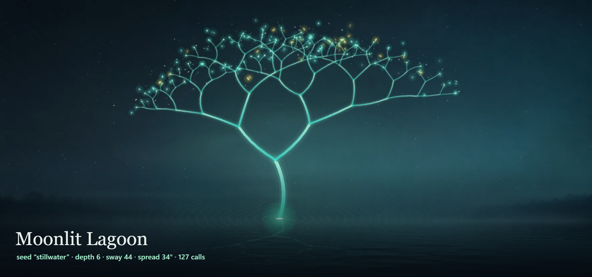
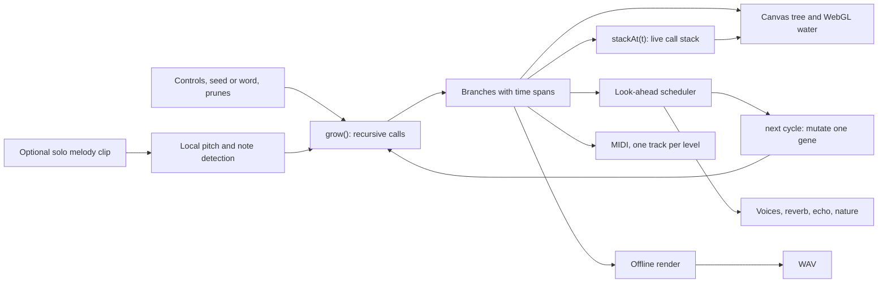

# Stillwater

**Hear the call stack.** One function grows a tree, and every call has a branch, a span of time and a voice. The music traces the live stack from trunk to leaf.

**Solo entry by Tanzamul-Azad for *Recursive Soundscapes*, Hub’s Quest Epoch 1.**

[Play online](https://tanzamul-azad.github.io/StillWater/) · [Hear Moonlit Lagoon](submission/moonlit-lagoon.wav) · [Hear Violet Hour](submission/violet-hour.wav) · [MIDI of three drifting cycles](submission/stillwater-callstack.mid) · [Judging walkthrough](submission/DEMO.md) · [AI development log](AI_LOG.md)



## The idea

Most recursive music walks a tree and plays one note per call. Stillwater gives each call **time** as well. The trunk owns the whole cycle. It hands the first part of its time to its left child and the rest to its right child, and every call does the same until it reaches a base case.

At any moment exactly one call per level is running, which is exactly the call stack. Each level has its own voice and register, so the stack becomes a chord:

| Level | Lasts | Voice in Moonlit Lagoon |
| --- | --- | --- |
| 0 · trunk | the whole cycle | warm drone pad |
| 1 | about half a cycle | bowed strings |
| 2 | a quarter | FM electric piano |
| 3 | an eighth | kalimba |
| 4–7 | shorter and shorter | bells, glass, harp, water drops |

Slow harmony at the bottom and quick melody at the top fall out of the recursion itself. This is how musical meter already works: whole notes split into halves, quarters and eighths.

```js
function grow(call) {
  sound(call);                          // push: a voice enters
  if (isBaseCase(call)) return;         // depth, a pruned cut, or too short to split
  const [early, late] = split(call.time, sway);
  grow(child(call, early, +interval));  // left child rises
  grow(child(call, late,  -interval));  // right child falls
}                                       // pop: the voice falls silent
```

## What you can do

- **Listen.** Press *Play the score* to hear one cycle. Turn on **Drift and repeat** to keep going while the score changes one interval gene at a time and shifts the key every few cycles.
- **See the recursion run.** The **call stack panel** lists the active `grow()` frames with their notes, and each frame's bar fills at the speed of that call. It sits beside the tree on wide screens and below it on smaller ones. A bead travels along every active branch. The **timeline** under the tree shows the time partition, one row per level.
- **Shape it.** *Depth* adds voices. *Sway* sets how each call splits its time, which shapes both the rhythm and the tree. *Spread* sets the melodic interval, from steps to wide leaps, and the stereo width. *Branch length* changes the shape. A **seed can be any word**: type your name to grow your own tree.
- **Prune.** With the Prune tool, tap a branch to turn it into a base case. Its voice holds, the levels above it rest, and the music breathes. Tap it again to let it regrow.
- **Listen inside.** Double-click a branch, or use *Explore → Listen inside*. Every subtree is a complete composition, so its span stretches to a full cycle and its levels are re-voiced.
- **Relax.** *Calm mode* expands the tree to the full screen with a breathing cue and playback controls. The controls fade when you're idle. The **breathing guide** uses left calls for the in-breath and right calls for the out-breath. The presets give right calls more time. Use the *sleep timer* to fade the score out, or raise the *Nature* slider to blend in ambience. Nature starts off by default and remembers the selected level.
- **Play by hand.** Tap or drag across the canopy to hear each branch's pitch and its level's instrument, or use the note keys. Choose *Manual* to pause the score and play on your own. Switch off *Water sounds* to mute the Lagoon water and Cedar rain in playback and WAV exports. Switching it on from a silent Nature mix blends water back into the score.
- **Plant a melody.** Open *Recursion → Plant a melody*, choose a clip of humming, isolated vocals, or a solo instrument, then select *Grow tree*. You can also try the built-in example. Stillwater detects pitches and relative lengths in the first 12 seconds, assigns the melody to the leaves, and voices the lower branches as harmony. The clip stays on your device. WAV, MIDI and share links use the resulting score, and only the notes are included in a share link.
- **Keep it.** Export a **WAV** (one cycle, or three or six drifting cycles), a **MIDI** file with one track per recursion level, a **postcard** image of the tree with its recipe, a **link** that regrows the current generation, or a **live recording** with your play-along. Longer WAV exports show cycle progress and gently crossfade between cycles.

## How the brief is met

| Mandatory deliverable | In Stillwater |
| --- | --- |
| Recursive algorithm with configurable parameters | `grow()` in [`src/score.mjs`](src/score.mjs). Depth, sway, spread, branch length, cycle, seed or word, plus pruned base cases |
| Interactive simulation or visualization | Growth in call order, a live call stack, beads on active calls, the time-partition timeline, morphing between drifted trees |
| Procedural music from the recursion | Pitch from the left/right path, rhythm from the time split, voice and register from depth, stereo from branch position, harmony from the stack |
| UI with parameter controls and playback | Controls with live re-scheduling, play and pause, seeking, drift, volume and nature mix, sleep timer, keyboard support |
| Audio export | Offline-rendered 44.1 kHz stereo WAV (one to six cycles), session recording, MIDI |
| Polished, accessible, relaxing | An intro that sets the mood, calm mode, breathing guide, reduced-motion support, keyboard alternatives for every pointer action, screen-reader labels |

## Sound design

Every sound is synthesized live with Web Audio. There are no samples.

- **Voices:** eight distinct instruments across the available depths of each soundscape, drawn from a sine pad with a soft octave harmonic, triangle strings, FM electric piano, kalimba, marimba, filtered harp, inharmonic bell, beating glass and pitched water drops. Branches at the same depth share an instrument and can have different notes. A hand-played branch uses a shorter envelope.
- **Space:** a generated stereo reverb whose tail darkens as it decays, two soft stereo echoes on the upper voices, a soft limiter, and a slight timing variation on the higher levels.
- **Scales:** pentatonic in every scene, and each level is kept in its own register, so every stack is consonant.
- **Nature beds, generated in code:** lapping water and crickets (Lagoon), rain and drips (Cedar), wind and chimes (Violet). Each is built from two loops of different lengths so the texture rarely repeats.

## Architecture



| Path | Responsibility |
| --- | --- |
| [`src/score.mjs`](src/score.mjs) | The recursion, time split, base cases, pitch registers, drift, listening inside, call stack lookup, share links |
| [`src/audio.mjs`](src/audio.mjs) | Voices, mix engine, generated nature beds, offline render, WAV encoder |
| [`src/player.mjs`](src/player.mjs) | Endless look-ahead scheduling, seamless cycle joins, live re-scheduling, session recording |
| [`src/garden.mjs`](src/garden.mjs) · [`src/water.mjs`](src/water.mjs) | Growth and morph animation, stack beads, breath ring, postcard, WebGL 2 water with a Canvas fallback |
| [`src/midi.mjs`](src/midi.mjs) | Type 1 MIDI with one track per level |
| [`src/melody.mjs`](src/melody.mjs) | Local audio decoding and pitch tracking of short, single-source melody clips. [YIN pitch tracking paper](https://doi.org/10.1121/1.1458024) |
| [`src/app.mjs`](src/app.mjs) | Interface, tools, calm mode, exports |

**Why this stack:** esbuild bundles plain ES modules into one script. Web Audio generates the score, Canvas 2D draws the interactive branches, and a WebGL 2 shader lights the water in a single draw call. The page runs offline from `dist/index.html`.

## Run and verify

```sh
npm ci
npm test        # Recursion, voices, melody detection and sharing, MIDI, WAV
npm run build   # bundles src/ into dist/stillwater.js
```

Open `dist/index.html`, or serve `dist/`. The GitHub Pages workflow runs the tests, rebuilds the bundle, checks it against the committed copy and deploys `dist/`.

The tests check that every call splits its parent's time exactly and that the leaves tile the cycle with no gaps. They also check that at every moment the sounding notes form one trunk-to-leaf path, that pruning changes only the pruned subtree, that each drift generation changes exactly one gene, and that a shared link regrows an identical tree.

Browser checks: Chrome desktop and mobile emulation, calm mode, pruning, listening inside, link restore, and WAV, MIDI and PNG export. A one-cycle WAV renders in about 3.5 s and peaks at −1.5 dBFS.

## Credits

All music, ambience and visuals are generated in code, except the lagoon backdrop photo, which was made for this project with an image generator. AI coding agents were used, and the full prompt chain with replies is in [`AI_LOG.md`](AI_LOG.md).
