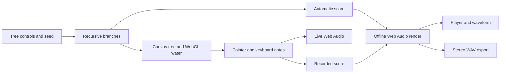

# Stillwater

**Play a recursive tree. Turn the shape of a branch into sound.**

Stillwater is a browser instrument for *Recursive Soundscapes*, Hub’s Quest Epoch 1. One recursive function creates both the tree you see and the notes you hear. Draw a melody by dragging across branches, or listen to the tree perform its own score.

**Solo entry by Tanzamul-Azad**

[Play online](https://tanzamul-azad.github.io/StillWater/) · [Watch the 30-second demo](submission/stillwater-demo.mp4) · [Hear the automatic score](submission/moonlit-lagoon.wav) · [Hear a recorded take](submission/by-hand.wav) · [AI development log](AI_LOG.md)


## Try it

1. **Play the branches.** Drag across the canopy with a mouse or finger. The note keys provide another way to play the same branches.
2. **Record your take.** Press the red record button, play a few notes, then press stop. The take captures note order, timing and repeated notes.
3. **Hear the recursion.** In **Explore branches**, choose any branch and select **Play path**. Hear each ancestor from the trunk to that branch while the corresponding path lights up.
4. **Shape and export.** Change depth, spread, branch length, tempo or seed. Play the generated score, switch to your recorded take, and export either as a 44.1 kHz stereo WAV.

Moonlit Lagoon, Cedar Rain and Violet Hour each set a different scale, timbre and ambience. A take can capture up to 24 seconds and 96 notes. The most recent take stays available while the page is open.

## How the recursion becomes music

The generator visits a branch, records its geometry and schedules a note. A non-terminal branch calls the generator for its left and right children at a reduced length. A terminal branch ends that call. The automatic performance uses pre-order traversal. Depth five produces **63 branches and 63 notes**, and the maximum depth of six produces **127**.

| Model input or property | Effect on the composition |
| --- | --- |
| Left and right turns | Different steps in the scene’s scale |
| Branch depth | Quieter, shorter notes toward the tips |
| Terminal call | Closer note spacing |
| Horizontal position | Stereo placement |
| The first split | Sustained harmony follows the two main subtrees |
| Seed | Repeatable variation in shape, pitch and timing |

The pointer selects actual branch geometry. A recorded gesture reuses those branch IDs and their assigned notes while preserving the player’s timing. The Web Audio performance buffer drives playback and WAV export. Rendered sample peaks fill in the waveform once the audio is ready.

## Architecture



## Implementation

| Path | Responsibility |
| --- | --- |
| [`src/score.mjs`](src/score.mjs) | Seeded recursion, geometry, note events and recorded takes |
| [`src/app.mjs`](src/app.mjs) | Pointer and keyboard input, recording, transport and downloads |
| [`src/garden.mjs`](src/garden.mjs), [`src/water.mjs`](src/water.mjs) | Canvas hit testing and branch rendering, WebGL effects with a Canvas fallback |
| [`src/audio.mjs`](src/audio.mjs) | Synthesized voices, ambience, stereo reverb and PCM encoding |
| [`dist/`](dist) | Prebuilt static site and offline entry point |
| [`scripts/score.test.mjs`](scripts/score.test.mjs) | Tests for recursion, take timing, branch paths and WAV encoding |
| [`submission/`](submission) | Demo video, WAV samples, screenshot and judging walkthrough |

Canvas keeps branch picking aligned with the rendered curves. WebGL handles mist and overlapping ripples at a lower render resolution while the tree remains sharp. Reduced motion removes those effects while preserving note feedback. The audio engine synthesizes the voices, ambience and reverb locally. The lagoon backdrop was created for this project with ImageGen. [Pointer Events](https://www.w3.org/TR/pointerevents3/) · [WebGL 2](https://registry.khronos.org/webgl/specs/latest/2.0/) · [Web Audio](https://www.w3.org/TR/webaudio/)

## Run and verify

For the quickest offline demo, download the [submission package](https://github.com/Tanzamul-Azad/StillWater/releases/latest), extract it, and open `dist/index.html` in a current browser. Keep its sibling files in place.

For development with Node.js 22 or later, run these commands from the repo root.

```sh
npm ci
npm test
npm run build
```

The GitHub Pages workflow runs the tests, rebuilds the bundle and checks it against the committed copy before deploying `dist/`. The seven unit tests cover tree termination, parent–child geometry, traversal order, seed repeatability, recorded timing, branch paths and WAV encoding. Browser checks covered Chrome, Edge, touch emulation, offline WAV export and WebGL recovery or fallback. The 127-note score and 96-note take tested without clipping.

[Judging walkthrough](submission/DEMO.md) · [Source and deliverables](https://github.com/Tanzamul-Azad/StillWater)
