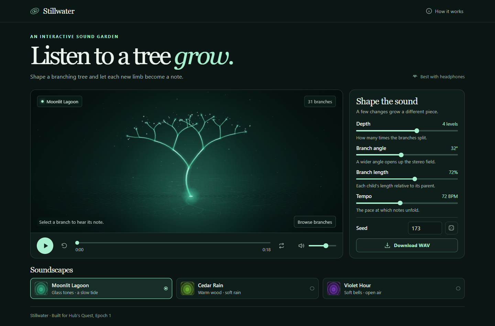

# Stillwater

**A recursive sound garden for Hub’s Quest, Epoch 1.**

Stillwater turns a tree into a composition. Every branch is born from a recursive call, and every call contributes a note. Press play to watch the tree light up in the order you hear it. Select any branch to audition its note and trace its path back to the trunk.



[Watch the 23-second demo](submission/stillwater-demo.mp4) · [Listen to Moonlit Lagoon](submission/moonlit-lagoon.wav) · [Demo walkthrough](submission/DEMO.md)

## Run locally

With Python 3 installed, run the following command from the repository root, then open `http://127.0.0.1:8765` in a current browser.

```sh
python -m http.server 8765 --bind 127.0.0.1 --directory dist
```

`dist/` is the complete static site. It can be served from a subpath and needs no build step, network services, external fonts, or audio samples. Web Audio playback starts after a user action.

## Play and shape a composition

1. Start with **Moonlit Lagoon**, **Cedar Rain**, or **Violet Hour**. Each has its own scale, instrument and ambient texture.
2. Adjust **Depth**, **Branch angle**, **Branch length**, or **Tempo**. The garden redraws immediately. Set a **Seed** to recall a variation or use the dice to discover another one.
3. Press **Play**. Use the timeline, restart, loop and volume controls to listen at your own pace. **Browse branches** provides a keyboard-accessible alternative to selecting the tree directly.
4. Choose **Download WAV** to save the current composition as stereo 44.1 kHz, 16-bit PCM. Export includes the complete piece and its reverb tail at the mastered level. Playback volume and loop are listening controls.

## How the recursion sounds

`grow()` creates a branch, schedules its note, and calls itself on two shorter branches. At the selected depth, it schedules the terminal note and returns. The pre-order walk plays the trunk, then the left subtree, then the right. Depth four makes 31 notes, and depth six makes 127.

| What changes in the tree | What changes in the sound |
| --- | --- |
| Left and right turns | Different steps in the preset’s scale |
| Depth and terminal calls | Softer, shorter notes further from the trunk and tighter spacing at the tips |
| Horizontal position | Stereo placement, so the sound follows the branch |
| First split | Sustained harmony follows the two main subtrees |
| Seed | Reproducible changes to pitch variation, timing and shape |

Soft attacks, limited overtones, a seeded stereo reverb and a filtered room tone keep the piece quiet and spacious. The tree and renderer share one score, so the visible branches, transport, and exported audio follow the same event order.

## Verify the score

Run `node --test scripts/score.test.mjs` with Node.js. The checks cover termination, parent–child geometry, traversal order, deterministic generation, and the WAV container. The interface also supports reduced motion without removing feedback about which branch is sounding.
